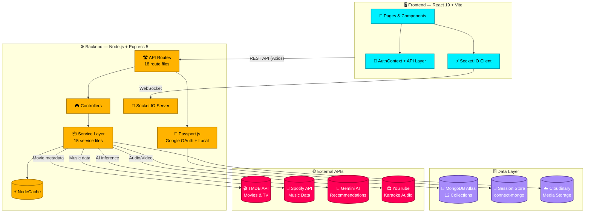
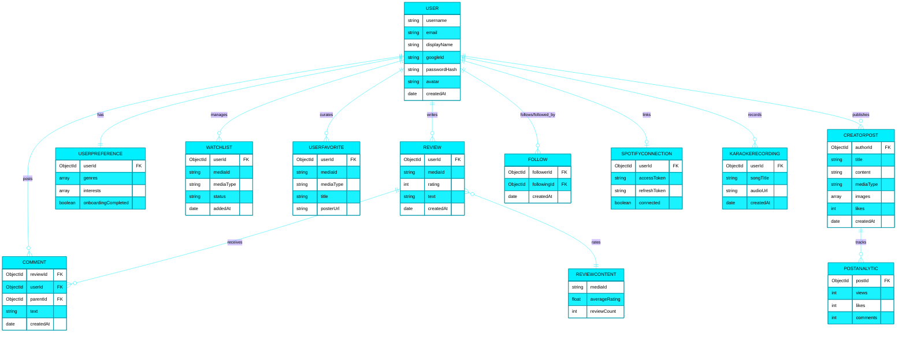
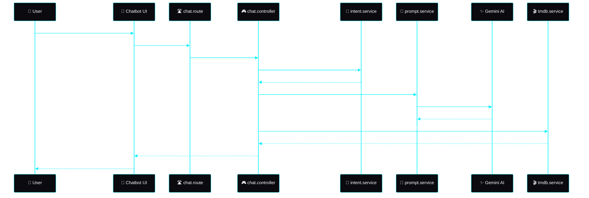
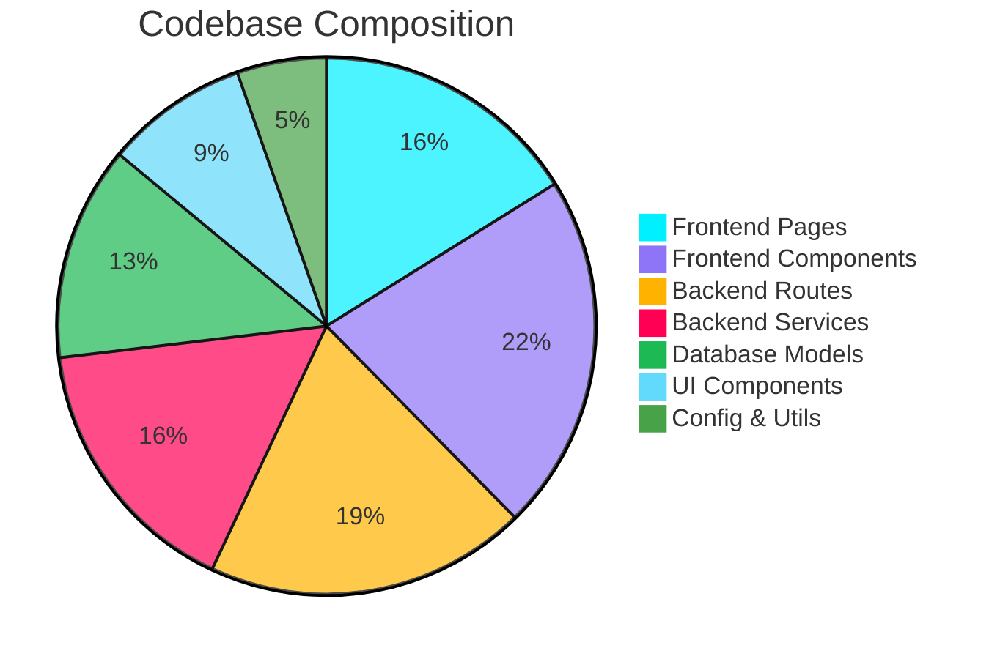

<div align="center">

<!-- Animated typing header using capsule-render -->


<br/>

<!-- Animated typing effect -->
<a href="https://git.io/typing-svg"></a>

<br/><br/>

<!-- Tech stack badges -->
[](https://www.mongodb.com/)
[](https://expressjs.com/)
[](https://react.dev/)
[](https://nodejs.org/)
[](https://vite.dev/)
[](https://tailwindcss.com/)
[](https://socket.io/)

<br/>

[](https://www.themoviedb.org/)
[](https://developer.spotify.com/)
[](https://ai.google.dev/)
[](https://developers.google.com/identity)
[](https://cloudinary.com/)

<br/><br/>

<!-- Dynamic stats -->


</div>

<br/>

---

<div align="center">

## 🌌 What is WatchVerse?

</div>

> **WatchVerse** is a next-generation **full-stack MERN entertainment ecosystem** that merges movie/TV discovery, music streaming, AI-powered recommendations, real-time social features, and creator tools into one cinematic experience.

It's not just another streaming site — it's a **living, breathing community** where you can discover content through AI conversations, watch movies together in synchronized rooms, sing karaoke with your friends, create posts as a content creator, and build your entertainment identity.

<div align="center">

```
🎬 Discover  →  🤖 AI Recommends  →  👥 Watch Together  →  ⭐ Review  →  🎤 Sing Along  →  📝 Create
```

</div>

---

## 🗺️ Table of Contents

<details>
<summary>📖 Click to expand</summary>

- [What is WatchVerse?](#-what-is-watchverse)
- [Feature Highlights](#-feature-highlights)
- [Feature Deep Dive](#-feature-deep-dive)
- [System Architecture](#-system-architecture)
- [Data Model](#-data-model)
- [AI Chatbot Pipeline](#-ai-chatbot-pipeline)
- [Tech Stack](#-tech-stack)
- [Project Structure](#-project-structure)
- [Getting Started](#-getting-started)
- [Environment Variables](#-environment-variables)
- [API Endpoints](#-api-endpoints)
- [Contributing](#-contributing)
- [Team](#-team)

</details>

---

## ⚡ Feature Highlights

<div align="center">

| Feature | Description | Tech |
|:---:|:---|:---:|
| 🏠 **Dynamic Home** | Hero banners, trending rows, genre collections with infinite scroll | React + TMDB |
| 🔐 **Google OAuth** | One-click sign-in with Google, session persistence | Passport.js |
| 🎵 **Spotify Integration** | Link Spotify → Get movie recs based on your music taste | Spotify Web API |
| 🤖 **AI Chatbot** | Natural language: *"Find me a thriller like Inception"* | Gemini AI |
| 🎉 **Watch Parties** | Create rooms, invite friends, sync video playback in real-time | Socket.IO |
| 🎤 **Karaoke Studio** | Sing along with synced lyrics, record & share vocal covers | Web Audio API |
| 📝 **Creator Hub** | Write posts, build following, creator analytics dashboard | MongoDB + Cloudinary |
| ⭐ **Reviews & Ratings** | 1-5 star ratings, threaded comments, community averages | MongoDB |
| 📋 **Smart Watchlist** | Track: *Want to Watch* → *Watching* → *Watched* | MongoDB |
| 👤 **Rich Profiles** | Activity feed, favorites, stats, follower system | Aggregation Pipeline |
| 🔍 **Advanced Filters** | Filter by genre, year, rating, type with real-time results | TMDB + Custom |
| 🃏 **Swipe Discovery** | Tinder-style swipe cards for quick content decisions | Framer Motion |

</div>

---

## 🎯 Feature Deep Dive

<details>
<summary><b>🏠 Dynamic Homepage</b></summary>
<br/>

The homepage is a cinematic experience inspired by premium streaming platforms:

- **🎬 Hero Banner** — Features a highlighted movie/show with backdrop, rating, and quick-action buttons
- **📊 Top 10 Trending** — Real-time trending content with numbered ranking badges
- **🎯 Recommended For You** — Personalized suggestions based on watch history and preferences
- **🎵 Spotify Mood Row** — Movies that match the vibe of your recent Spotify listens
- **📂 Genre Collections** — Action, Comedy, Drama, Sci-Fi, Horror, and more
- **♾️ Infinite Scroll** — Seamless pagination that loads more content as you scroll
- **💀 Skeleton Loading** — Beautiful shimmer animations while content loads

</details>

<details>
<summary><b>🔐 Authentication & Onboarding</b></summary>
<br/>

- **Google OAuth 2.0** — Secure, one-click Google sign-in via Passport.js
- **Local Auth** — Traditional email/password registration with bcrypt hashing
- **Session Management** — Persistent sessions stored in MongoDB via connect-mongo
- **Smart Onboarding** — New users pick favorite genres and interests to seed recommendations
- **Protected Routes** — Automatic redirects for unauthenticated users

</details>

<details>
<summary><b>🎵 Spotify Integration</b></summary>
<br/>

WatchVerse bridges the gap between music and movies:

```
🎧 Your Spotify → 🧠 Mood Analysis → 🎬 Movie Recommendations
```

- **OAuth Flow** — Connect/disconnect Spotify with a single click
- **Listening Analysis** — Analyzes your top tracks, artists, and audio features
- **Cross-Media Recs** — If you listen to dark, atmospheric music → get thriller/noir movie suggestions
- **Music Row** — Dedicated "Songs for your mood" row on the homepage
- **Profile Integration** — Your Spotify connection status visible on your profile

</details>

<details>
<summary><b>🤖 AI Media Assistant Chatbot</b></summary>
<br/>

A conversational AI that understands entertainment like a film-buff friend:

- **Natural Language** — Ask anything: *"What's a good movie for date night?"*
- **Intent Classification** — Automatically detects if you want recommendations, cast info, ratings, or storylines
- **Contextual Memory** — Remembers conversation context within a session
- **Rich Cards** — Returns interactive movie/show cards with posters, ratings, and direct links
- **Library Sync** — Optionally syncs your watchlist so it knows what you've already seen
- **Animated UI** — Features a glowing animated orb that pulses while thinking

</details>

<details>
<summary><b>🎉 Watch Parties & Watch Rooms</b></summary>
<br/>

Watch movies together, no matter where you are:

- **Create Rooms** — Generate a unique room with a shareable link
- **Synchronized Playback** — Play/pause/seek syncs across all viewers in real-time
- **Live Chat** — Built-in real-time chat sidebar powered by Socket.IO
- **Participant Tracking** — See who's in the room with live avatars
- **Immersive Mode** — Full-screen experience with hidden navbar for cinematic viewing

</details>

<details>
<summary><b>🎤 Karaoke Studio</b></summary>
<br/>

A full-featured karaoke experience built right into the platform:

- **🎵 Synced Lyrics** — Real-time scrolling and highlighting of lyrics (including transliterated/Romanized for Hindi tracks)
- **🎶 Auto-Play Backing Music** — HTML5 audio player + YouTube video integration
- **📊 Voice Visualizer** — Canvas-based real-time frequency visualization using Web Audio API
- **🎙️ Recording** — Record your vocals using the browser's MediaRecorder API
- **🎚️ Vocal Mixer** — Automatically mix your recorded voice with the backing track
- **☁️ Community Submissions** — Save covers to Cloudinary and share in the Community Recordings gallery

</details>

<details>
<summary><b>📝 Creator Hub & Studio</b></summary>
<br/>

Turn consumers into creators:

- **Creator Studio** — Rich text editor for writing posts about movies, series, and music
- **Media Attachments** — Upload images via Cloudinary integration
- **Creator Feed** — Scrollable feed of all creator posts with engagement metrics
- **Analytics Dashboard** — Track views, likes, and engagement on your posts
- **Follow System** — Follow creators and see their content in your feed
- **Comments & Discussions** — Threaded comment system on every post

</details>

<details>
<summary><b>👤 Profiles & Social</b></summary>
<br/>

Your entertainment identity:

- **Profile Page** — Avatar, display name, stats banner, and activity feed
- **Favorites Collection** — Curated list of favorite movies, shows, and songs
- **Review History** — All your reviews and ratings in one place
- **Follower/Following** — Social graph with follow/unfollow functionality
- **Activity Stats** — Reviews written, watchlist items, favorites count
- **Public Profiles** — Click any username anywhere to view their profile

</details>

---

## 🏗️ System Architecture



---

## 🗃️ Data Model



---

## 🤖 AI Chatbot Pipeline

How a natural-language question becomes a personalized recommendation:



---

## 🛠️ Tech Stack

<div align="center">

### Frontend

| Technology | Purpose |
|:---:|:---|
|  | UI framework with hooks & context |
|  | Lightning-fast dev server & bundler |
|  | Utility-first styling with glassmorphism design |
|  | Fluid animations & page transitions |
|  | Client-side routing |
|  | Real-time watch party communication |
|  | API communication layer |
|  | Creator analytics charts |

### Backend

| Technology | Purpose |
|:---:|:---|
|  | JavaScript runtime |
|  | REST API framework |
|  | NoSQL database |
|  | ODM with schema validation |
|  | Google OAuth + Local authentication |
|  | Real-time bidirectional events |
|  | Image & audio cloud storage |
|  | Runtime input validation |

### External APIs & AI

| Service | Purpose |
|:---:|:---|
|  | Movie & TV metadata, posters, trending |
|  | Music data, user listening history, mood analysis |
|  | AI-powered chatbot & recommendations |
|  | Secure third-party authentication |

</div>

---

## 📊 Codebase Overview



<div align="center">

| Metric | Count |
|:---|:---:|
| 📄 Frontend Pages | **15** |
| 🧩 React Components | **28+** |
| 🛣️ API Route Files | **18** |
| ⚙️ Service Files | **15** |
| 🗄️ Database Models | **12** |
| 🌐 External API Integrations | **4** |
| 🔌 WebSocket Events | **Real-time** |

</div>

---

## 📁 Project Structure

```
WatchVerse/
│
├── 🖥️ Frontend/
│   ├── src/
│   │   ├── components/
│   │   │   ├── AnimatedOrb.jsx            # AI chatbot pulsing orb animation
│   │   │   ├── MediaAssistantChatbot.jsx  # Full AI chatbot interface (1690 lines!)
│   │   │   ├── MediaCard.jsx              # Movie/TV content card
│   │   │   ├── MusicMediaCard.jsx         # Music-specific content card
│   │   │   ├── Navbar.jsx                 # Global navigation with mobile responsive
│   │   │   ├── PrismoLogo.jsx             # Animated brand logo
│   │   │   ├── ReviewComments.jsx         # Threaded review & comment system
│   │   │   ├── SpotifyRecommendations.jsx # Spotify-powered recommendation rows
│   │   │   ├── SplashScreen.jsx           # Cinematic loading screen
│   │   │   ├── StarRating.jsx             # Interactive star rating component
│   │   │   ├── SwipeCard.jsx              # Tinder-style swipe card
│   │   │   ├── SwipeStack.jsx             # Swipe discovery stack manager
│   │   │   ├── profile/                   # Profile sub-components
│   │   │   ├── studio/                    # Creator studio sub-components
│   │   │   ├── ui/                        # Shared UI (ErrorBoundary, Skeleton, etc.)
│   │   │   └── watchparty/                # Watch party components + Sonner toasts
│   │   │
│   │   ├── pages/
│   │   │   ├── Home.jsx                   # Dynamic homepage with 10+ content rows
│   │   │   ├── Browser.jsx                # Advanced search & filter page
│   │   │   ├── Detail.jsx                 # Movie/TV detail with reviews
│   │   │   ├── Login.jsx                  # Auth page with Google OAuth
│   │   │   ├── Register.jsx               # Registration with validation
│   │   │   ├── onBoarding.jsx             # Genre & interest picker
│   │   │   ├── Profile.jsx                # User profile with stats
│   │   │   ├── Watchlist.jsx              # Personal watchlist manager
│   │   │   ├── WatchParty.jsx             # Watch party lobby
│   │   │   ├── WatchRoom.jsx              # Synchronized video room
│   │   │   ├── Karaoke.jsx                # Full karaoke studio
│   │   │   ├── CreatorStudio.jsx          # Content creation editor
│   │   │   ├── CreatorFeed.jsx            # Creator post feed
│   │   │   ├── WatchCreatorPost.jsx       # Individual post viewer
│   │   │   └── ConnectSpotify.jsx         # Spotify OAuth flow
│   │   │
│   │   ├── context/
│   │   │   └── AuthContext.jsx            # Global auth state management
│   │   ├── lib/
│   │   │   └── api.js                     # Axios instance with interceptors
│   │   ├── App.jsx                        # Root app with routing
│   │   └── index.css                      # Global styles + Tailwind
│   │
│   ├── vite.config.js
│   ├── tailwind.config.js
│   └── package.json
│
├── ⚙️ Backend/
│   ├── Models/
│   │   ├── User.js                        # User schema (Google + local auth)
│   │   ├── Review.js                      # Movie/TV reviews
│   │   ├── Comment.js                     # Threaded comments on reviews
│   │   ├── WatchList.js                   # Watchlist entries
│   │   ├── UserPreference.js              # Onboarding preferences
│   │   ├── UserFavorite.js                # Curated favorites
│   │   ├── CreatorPost.js                 # Creator content posts
│   │   ├── Follow.js                      # Social follow graph
│   │   ├── PostAnalytic.js                # Creator analytics
│   │   ├── SpotifyConnection.js           # Spotify OAuth tokens
│   │   ├── KaraokeRecording.js            # Saved karaoke recordings
│   │   └── reviewContent.js               # Aggregated review stats
│   │
│   ├── controllers/
│   │   └── chat.controller.js             # AI chatbot orchestration
│   │
│   ├── routes/
│   │   ├── auth.route.js                  # Google OAuth + local auth
│   │   ├── home.route.js                  # Homepage data aggregation
│   │   ├── movieContent.route.js          # Movie/TV detail endpoints
│   │   ├── reviews.route.js               # CRUD reviews
│   │   ├── comments.route.js              # CRUD comments + threads
│   │   ├── watchlist.route.js             # Watchlist management
│   │   ├── watchparty.route.js            # Watch party CRUD + Socket.IO
│   │   ├── chat.route.js                  # AI chatbot endpoint
│   │   ├── creator.route.js               # Creator post CRUD
│   │   ├── follow.route.js                # Follow/unfollow system
│   │   ├── favorites.route.js             # User favorites management
│   │   ├── karaoke.route.js               # Karaoke songs + recordings
│   │   ├── profile.route.js               # Profile data aggregation
│   │   ├── profile.activity.route.js      # Activity feed
│   │   ├── onboarding.route.js            # Onboarding flow
│   │   ├── spotify.personalization.route.js # Spotify mood-based recs
│   │   ├── spotify.profile.route.js       # Spotify profile data
│   │   └── index.js                       # Route registry
│   │
│   ├── services/
│   │   ├── tmdb.service.js                # TMDB API wrapper (24KB!)
│   │   ├── spotify.service.js             # Spotify API integration
│   │   ├── spotifyPersonalization.service.js # Mood analysis engine
│   │   ├── spotify.profile.service.js     # Spotify profile data
│   │   ├── gemini.service.js              # Google Gemini AI wrapper
│   │   ├── intent.service.js              # NLP intent classifier
│   │   ├── prompt.service.js              # Dynamic prompt builder
│   │   ├── mediaClassifier.service.js     # Media type classifier
│   │   ├── home.service.js                # Homepage data orchestrator
│   │   ├── lyrics.service.js              # Lyrics fetching + sync (21KB!)
│   │   ├── creator.service.js             # Creator post service
│   │   ├── profile.service.js             # Profile aggregation
│   │   ├── movieContent.service.js        # Movie detail service
│   │   ├── statistics.service.js          # User stats calculator
│   │   └── activity.js                    # Activity tracking
│   │
│   ├── config/                            # Passport & DB configuration
│   ├── lib/                               # Shared utilities
│   └── server.js                          # Express app + Socket.IO setup
│
└── README.md                              # You are here! 📍
```

---

## 🚀 Getting Started

### Prerequisites

Make sure you have these installed:

| Requirement | Version |
|:---|:---|
|  | v18+ |
|  | v9+ |
|  | Atlas or Local |
|  | Latest |

### Installation

```bash
# 1️⃣ Clone the repository
git clone https://github.com/shiva122019/WatchVerse.git
cd WatchVerse

# 2️⃣ Install backend dependencies
cd Backend
npm install

# 3️⃣ Install frontend dependencies
cd ../Frontend
npm install

# 4️⃣ Set up environment variables (see below)
# Create .env files in both Backend/ and Frontend/

# 5️⃣ Start the backend server
cd ../Backend
npm start
# ✅ Server running on http://localhost:3000

# 6️⃣ Start the frontend dev server
cd ../Frontend
npm run dev
# ✅ App running on http://localhost:5173
```

---

## 🔑 Environment Variables

### Backend `.env`

```env
# Database
MONGODB_URI=mongodb+srv://your-connection-string

# Session
SESSION_SECRET=your-session-secret

# Google OAuth
GOOGLE_CLIENT_ID=your-google-client-id
GOOGLE_CLIENT_SECRET=your-google-client-secret
GOOGLE_CALLBACK_URL=http://localhost:3000/api/auth/google/callback

# TMDB
TMDB_API_KEY=your-tmdb-api-key

# Spotify
SPOTIFY_CLIENT_ID=your-spotify-client-id
SPOTIFY_CLIENT_SECRET=your-spotify-client-secret

# Google Gemini AI
GEMINI_API_KEY=your-gemini-api-key

# Cloudinary
CLOUDINARY_CLOUD_NAME=your-cloud-name
CLOUDINARY_API_KEY=your-cloudinary-key
CLOUDINARY_API_SECRET=your-cloudinary-secret

# Frontend URL (CORS)
CLIENT_URL=http://localhost:5173
```

### Frontend `.env`

```env
VITE_API_URL=http://localhost:3000/api
```

---

## 🔌 API Endpoints

<details>
<summary><b>🔐 Authentication</b> — <code>/api/auth</code></summary>

| Method | Endpoint | Description |
|:---:|:---|:---|
| `GET` | `/google` | Initiate Google OAuth flow |
| `GET` | `/google/callback` | Google OAuth callback |
| `POST` | `/register` | Register with email/password |
| `POST` | `/login` | Login with credentials |
| `GET` | `/me` | Get current user session |
| `POST` | `/logout` | Destroy session |

</details>

<details>
<summary><b>🏠 Homepage</b> — <code>/api/home</code></summary>

| Method | Endpoint | Description |
|:---:|:---|:---|
| `GET` | `/` | Aggregated homepage data |
| `GET` | `/section` | Paginated section data |

</details>

<details>
<summary><b>🔍 Browse & Content</b> — <code>/api/content</code></summary>

| Method | Endpoint | Description |
|:---:|:---|:---|
| `GET` | `/search` | Search movies, TV, music |
| `GET` | `/:type/:id` | Get content detail |
| `GET` | `/:type/:id/credits` | Get cast & crew |

</details>

<details>
<summary><b>⭐ Reviews & Comments</b></summary>

| Method | Endpoint | Description |
|:---:|:---|:---|
| `POST` | `/api/reviews` | Create review |
| `GET` | `/api/reviews/:mediaId` | Get reviews for content |
| `POST` | `/api/comments` | Add comment to review |
| `GET` | `/api/comments/:reviewId` | Get comment thread |

</details>

<details>
<summary><b>📋 Watchlist</b> — <code>/api/watchlist</code></summary>

| Method | Endpoint | Description |
|:---:|:---|:---|
| `POST` | `/` | Add to watchlist |
| `GET` | `/` | Get user's watchlist |
| `PATCH` | `/:id` | Update status |
| `DELETE` | `/:id` | Remove from watchlist |

</details>

<details>
<summary><b>🎉 Watch Party</b> — <code>/api/watchparty</code></summary>

| Method | Endpoint | Description |
|:---:|:---|:---|
| `POST` | `/` | Create watch party room |
| `GET` | `/:roomId` | Get room details |
| `WS` | `connection` | Socket.IO real-time sync |

</details>

<details>
<summary><b>🤖 AI Chat</b> — <code>/api/chat</code></summary>

| Method | Endpoint | Description |
|:---:|:---|:---|
| `POST` | `/` | Send message to AI assistant |

</details>

<details>
<summary><b>🎤 Karaoke</b> — <code>/api/karaoke</code></summary>

| Method | Endpoint | Description |
|:---:|:---|:---|
| `GET` | `/songs` | Browse available songs |
| `GET` | `/songs/:id/lyrics` | Get synced lyrics |
| `POST` | `/recordings` | Save a recording |
| `GET` | `/recordings` | Community recordings |

</details>

<details>
<summary><b>📝 Creator</b> — <code>/api/creator</code></summary>

| Method | Endpoint | Description |
|:---:|:---|:---|
| `POST` | `/posts` | Create a post |
| `GET` | `/feed` | Get creator feed |
| `GET` | `/posts/:id` | Get single post |
| `POST` | `/posts/:id/like` | Like a post |

</details>

<details>
<summary><b>🎵 Spotify</b></summary>

| Method | Endpoint | Description |
|:---:|:---|:---|
| `GET` | `/api/spotify/personalized` | Mood-based movie recs |
| `GET` | `/api/spotify/profile` | Spotify profile data |

</details>

---

## 👥 Team

<div align="center">

Made with ❤️ and lots of ☕ by the **WatchVerse Team**

<br/>

[](https://github.com/shiva122019)

</div>

---

<div align="center">

<!-- Footer wave -->


<br/>

**⭐ Star this repo if you found it interesting!**

<br/>

*Built with the MERN Stack · Powered by AI · Designed for the Community*

</div>
